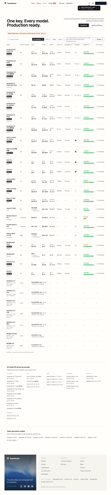
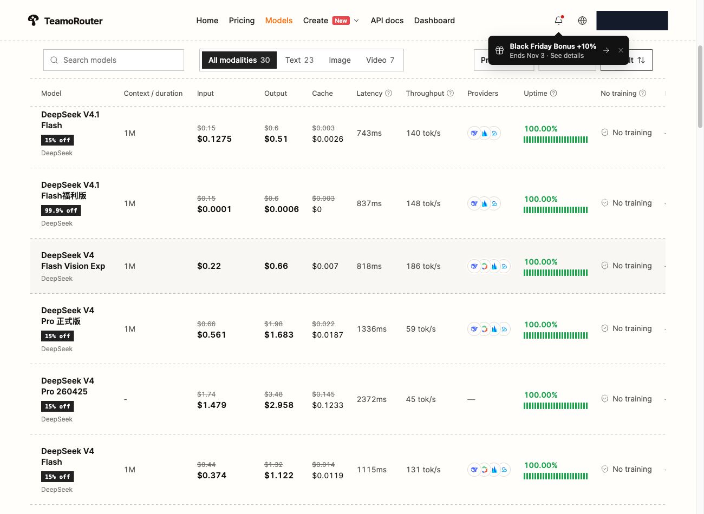

# TeamoRouter 生图与视频 API 指南：按秒计费的 Seedance 怎么买最省

想在同一个网关里既跑文本又跑视频时，最容易踩的坑是**计价单位混着看**：文本按百万 token，视频按秒。TeamoRouter 的目录页把这两类并列展示，当前 **30 个模型（文本 23 / 视频 7）**，全部美元标价。这篇只讲一件事：视频和文本怎么分别算账，以及从哪一档开始试。

[打开 TeamoRouter 模型与价格页](https://teamorouter.com/share?i=e6d77aac74)

> **Decision:** 需要「文本 + 视频」共用一个 Key、并且愿意按美元预算时选它；只买一个廉价文本模型、或必须人民币充值时换别家。
>
> **For:** 做短视频批量生成同时又要跑文案/代码的团队  ·  **Not for:** 纯文本用户、只接受支付宝付款的用户

## 视频按秒，先算单条再算月度

Seedance 系列的价格写法是「from $X / 秒」加一个 5 秒样例估算。按当前目录：

| 型号 | 起价 | 5 秒 720p 估算 | 时长范围 |
|---|---|---|---|
| Seedance 2.5 | $0.090 / 秒 | ≈ $0.97 | 4–30s |
| Seedance 2.5 Flex | $0.080 / 秒 | ≈ $0.86 | 4–30s |
| Seedance 2.0 | $0.059 / 秒 | ≈ $0.64 | 4–15s |
| Seedance 2.0 Fast | $0.048 / 秒 | ≈ $0.51 | 4–15s |
| Seedance 2.0 Mini | $0.030 / 秒 | ≈ $0.32 | 4–15s |

算法是单价 × 秒数，分辨率更高、时长更长都会往上加。**别拿 5 秒样例价当固定价**：样例是 720p、5 秒的特定组合。

一个月出 60 条 5 秒 720p，用 Mini 大约 $19，用 2.5 大约 $58。差价来自档位，不是来自折扣 —— 先确认自己需不需要 2.5 的画质，再决定充值额度。

如果一条片子要 15 秒、1080p，先按秒单价乘 15 得到时长基数，再确认该分辨率是否另有加价档。**不要在没确认分辨率加价规则前，用 720p 的样例价去估 1080p 的成本**，这是最容易低估的一步。

[按当前价目表确认自己的型号与档位](https://teamorouter.com/share?i=e6d77aac74)

## 文本按 token，两行数字只取一行

文本模型给的是 **USD / 1M token**，输入、输出、Cache 三列分开。目录单元格常出现上下两行，比如 `$1.4` 与 `$0.7126` 并排、附注 `49% off`。**下面那行是折后实付价，两行不能相加。**

几个当前目录里的锚点（每百万 token，输入 / 输出）：

- DeepSeek V4.1 Flash：$0.3 / $1.2（1M 上下文）
- GLM-5.3：$1.4 / $4.4（1M 上下文）
- Qwen3.8 Max：$1.7143 / $5.1429（1M 上下文）
- Kimi K3.1 Pro：$2 / $10（1M 上下文）

标 `Context-tiered pricing` 的型号单价随上下文长度变化，长文档任务要按真实长度估，不能套列表里的单值。

还有一个容易忽略的项：**Cache 列**。多数文本型号有独立的缓存读单价，通常远低于输入价。同一份长文档反复提问时，缓存命中能显著压低成本；但缓存有存活时间，跨天复用不一定命中，不能按「永远命中」做预算。

## 一个账户、两条 Key 的分账方式

充值档位是 $10 / $20 / $50 / $200，自定义最低 $5，Stripe checkout，美元面值入账；站方说明无订阅、Credits 不过期。

建两条 Key：一条只跑文本、一条只跑视频，各自设额度。这样做的好处是视频任务超支时不会把文本预算一起吃掉，账单也能直接归因到任务类型。

Base URL 是 `https://api.teamorouter.cn/v1`，OpenAI 与 Anthropic 两种协议都支持，现有客户端填地址 + Key 即可，不用改代码。

第一次接入建议只跑一次最小调用：发一句短提示，确认返回正常、扣费正确，再上批量任务。跳过这一步直接跑长任务，出问题时分不清是协议填错还是额度不足。

[从小额开始验证接入](https://teamorouter.com/share?i=e6d77aac74)

## 什么时候它不如别的选择

如果你只跑文本，视频能力对你没有价值，但定价结构里包含了这部分供给，用专门的低价文本站更省。如果你必须用人民币充值或支付宝付款，当前公开页面写的是 Stripe 美元结算，这条要先确认。

另一个边界：**没有按张计费的图片模型**。当前 30 个型号里 Image 分类为空。如果你的主任务是批量出图，应该另找按次计费的站，而不是指望这里的视频型号替代。

## 三类任务的选法

按任务倒推，比按型号挑更省时间：

- **批量短视频**：Seedance 2.0 Mini 起步，跑通再考虑 2.5；预算按「条数 × 秒数 × 单价」算。
- **日常文本/代码**：DeepSeek 或 GLM 的折扣档，先跑通客户端和计费。
- **长文档分析**：选 1M 上下文档位，并且优先看 Cache 读价，而不是只看输入价。

这三类不要共用一条 Key。混用之后账单无法归因，也就没法判断哪一类该加预算、哪一类该砍。

## Related guides

同账号按场景拆开的中转站指南，配着看更省时间：

- [哈基米 API 指南](https://github.com/barlowhoppe/hakimi-api-guide) —— 生图按次计费，和按秒的视频计价正好互补
- [VS 云指南](https://github.com/barlowhoppe/vsllm-guide) —— 高频短请求的按次路线，适合先把文本成本压下来
- [HC 网关指南](https://github.com/barlowhoppe/hc-api-guide) —— 免费层 + 订阅的组合，适合预算极紧的起步阶段

## FAQ

### 视频和文本共用一个余额吗？

共用一个账户余额，但建议分 Key 设额度，避免互相挤占。

### 5 秒样例价是最终价吗？

不是。样例是「5 秒 + 720p」的特定组合估算，改分辨率或时长都要重算。

### 折扣价能锁定吗？

不能。折扣是阶段性活动，站方按请求当时价格计费。做预算按原价算更稳。

### 能出图片吗？

当前目录里 Image 分类没有型号。需要批量出图请另选按次计费的站。

---

这篇如果帮你把账算清了，给这个仓点个 star，价目变动时更新会直接到你这里。
